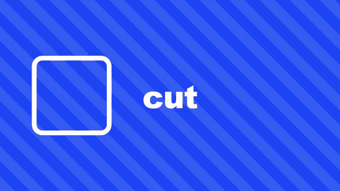

<div align="center">

# remotion-snap-transitions

**The fast cut transitions short-form editors actually use, for [Remotion](https://www.remotion.dev).**
Measured frame by frame on hand-edited videos, not eyeballed.

[](LICENSE)




<sub>Each shot is named after the transition that brings it in. Graphics only, rendered with <code>npm run render-demo</code>.</sub>

</div>

## Why

`@remotion/transitions` is made for slides: a fade or a wipe that overlaps two scenes for 15 to 30 frames.
TikTok, Reels and YouTube edits don't work like that. The cut stays hard, and a **1 to 6 frame accent** sells it:
two frames of white, a single smeared frame, a mirrored slide that is gone in 12 frames.

This library adds those accents **on top of your hard cuts**. Your timeline does not change, scenes never overlap,
and one line per cut is enough.

## Quick start

```bash
npm install github:Rubens29r/remotion-snap-transitions
```

Or copy [`src/SnapTransitions.tsx`](src/SnapTransitions.tsx) into your project: one file, no dependencies beyond
`react` and `remotion`.

```tsx
import { Series } from "remotion";
import { SnapTransitions } from "remotion-snap-transitions";

export const MyVideo = () => (
  <SnapTransitions
    cuts={[
      { frame: 45, type: "whip" },
      { frame: 90, type: "flash" },
      { frame: 150, type: "mirror-slide", direction: "right" },
    ]}
  >
    <Series>
      <Series.Sequence durationInFrames={45}><Intro /></Series.Sequence>
      <Series.Sequence durationInFrames={45}><Problem /></Series.Sequence>
      <Series.Sequence durationInFrames={60}><Punchline /></Series.Sequence>
      <Series.Sequence durationInFrames={60}><Outro /></Series.Sequence>
    </Series>
  </SnapTransitions>
);
```

`frame` is the first frame of the next shot. Everything inside `<SnapTransitions>` moves like a camera; put titles,
captions and your logo **outside** it to keep them still.

## The transitions

| Type | Length | What happens | Use it for |
|---|---|---|---|
| `flash` | 2 frames after the cut | White pop at 79 % then 59 % | A punchline, a beat drop |
| `flash-full` | 5 frames around the cut | The cut hides under a 98 % white | A new chapter |
| `whip` | 1 + 3 frames | One smeared frame, then the next shot lands at 120 % and settles | A fast change of topic |
| `mirror-slide` | 12 frames | The picture slides away, edges mirrored, motion blur on 4 frames | "Meanwhile…", moving on |
| `zoom-blur` | 8 frames | Punch in and blur out, then the next shot comes back into focus | Diving into a detail |
| `bullet` | 6 frames | Vertical smear: out at the top, in from the bottom | Up / down energy, a list |
| `vhs` | 12 frames | Tape glitch: jump, scan lines, snow, colours bleeding | A flashback, an archive, a rewind |

## Options

```ts
type Cut = {
  frame: number;                 // first frame of the next shot
  type: "flash" | "flash-full" | "whip" | "mirror-slide" | "zoom-blur" | "bullet" | "vhs";
  duration?: number;             // stretch or tighten the effect (frames); defaults to the measured length
  blur?: number;                 // multiplies every blur (1 = measured)
  direction?: "left" | "right" | "up" | "down"; // whip, mirror-slide (default left), bullet (default up)
  whites?: number[];             // flash, flash-full: your own white opacity per frame
};
```

Follow the motion in your footage: if the subject moves right, use `direction: "right"`.

## Measured, not eyeballed

Every number in the source comes from frame-by-frame analysis of hand-made edits: white level of each frame,
displacement as a share of the width, and sharpness read as the variance of the Laplacian, then turned back into a
blur radius. Blur radii scale with your resolution (they were measured at 1080 px wide), so 720p and 4K look the same.

## How it works

- One wrapper moves the whole picture (`translate` + `scale`), like a camera.
- Mirrored edges: for a few frames the children are drawn three times, flipped and glued to the frame, so a slide
  never shows a black border.
- Directional motion blur is an SVG `feGaussianBlur` with a separate X / Y deviation.
- The VHS noise uses Remotion's `random(seed)`: every render gives the same frames, and parallel rendering stays exact.

Keep `<Audio>` outside `<SnapTransitions>`: mirrored frames would play it three times.

## Demo

```bash
npm install
npm run demo          # opens Remotion Studio on example/
npm run render-demo   # writes out/demo.mp4
```

## License

[MIT](LICENSE)
